# Unmesha Arts — Custom Pencil Portrait Booking Site

> A fully live portrait booking platform for hand-drawn pencil portraits, made to order. Upload a photo, pick a size and detail level, pay by UPI — a real artist draws it and ships it to your door.

🌐 **Live site:** [https://unmesha-arts.web.app](https://unmesha-arts.web.app)

Built with plain HTML, CSS and JavaScript. Deployed on Firebase Hosting. Backend powered by Firebase Auth + Firestore. Image uploads via Cloudinary.

---

## Table of Contents

- [What it does](#what-it-does)
- [Screenshots](#screenshots)
- [Tech Stack](#tech-stack)
- [Project Structure](#project-structure)
- [How it works (user flow)](#how-it-works-user-flow)
- [Roles](#roles)
- [Setup & Deployment](#setup--deployment)
- [Pricing](#pricing)
- [Author](#author)

---

## What it does

- Customers browse a live gallery of real hand-drawn portraits by artist
- Pick size (A2 / A3 / A4), detail level (low / medium / high), number of faces — price calculates instantly
- Submit a booking with a reference photo — account is created automatically
- Artist confirms the order and generates a UPI QR code for the exact amount
- Customer scans the QR from their dashboard and uploads a payment screenshot
- Artist/admin confirms payment and marks the order complete
- Finished portrait is shipped to the customer's door

No payment gateway. No commission fees. Direct UPI — the full amount goes straight to the artist.

---

## Screenshots

### Login Page
Two-panel login page — Oscar Wilde quote and how-it-works steps on the left, clean login form on the right with WhatsApp and Call shortcuts.

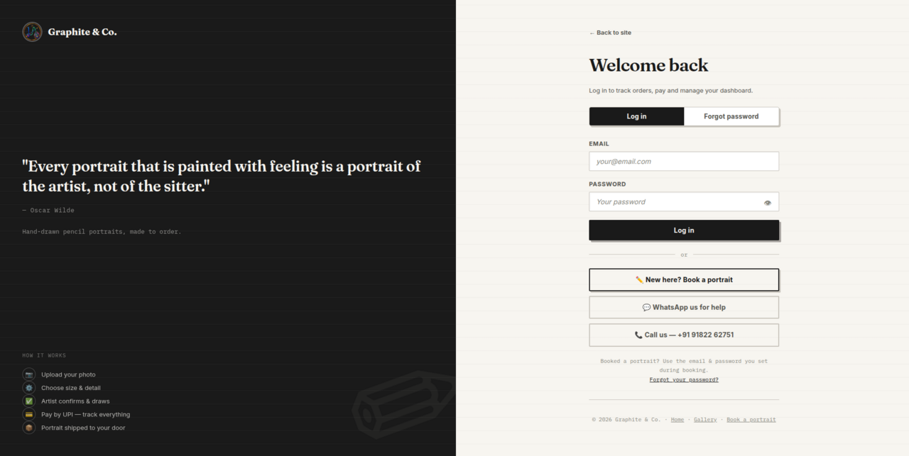

---

### Homepage — Hero Section
The public landing page hero: *"Your photo, hand-drawn in graphite."* Stats bar showing portraits delivered, artists, and sizes available (A2–A4).

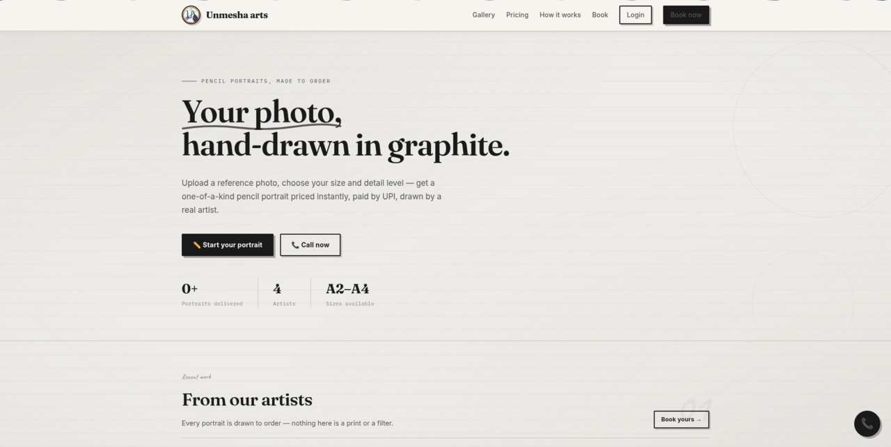

---

### Gallery — Artist Work (Page 1)
The public gallery filtered by **All artists** — shows real hand-drawn work with title, size, detail level and artist name on each card. Artists shown: Akash arts, Pragadareddy Rani.

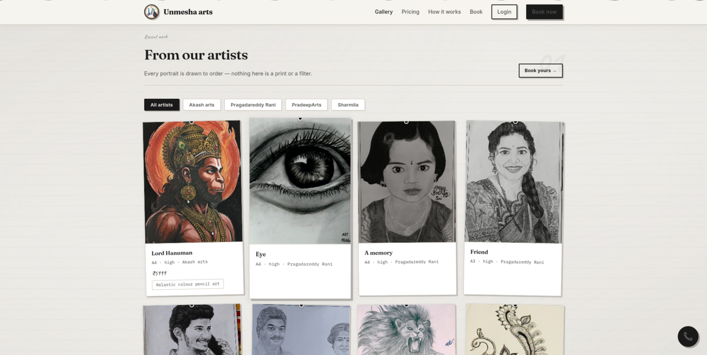

---

### Gallery — Artist Work (Page 2)
More gallery works — Paid art, Father's boss, Lord Narshimha, Peacock, Rose in hand, Ghost rider, Design — across multiple artists.

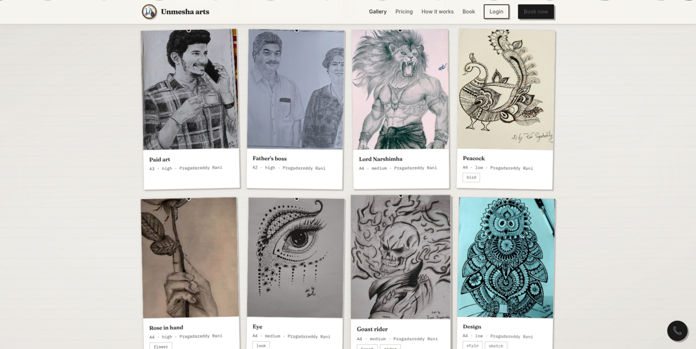

---

### Gallery — Artist Work (Page 3)
Gallery continued — Sivakarthikeyan, Water falls, Nature, White horse (Sharmila), and portrait sketches from PradeepArts including an anime character.

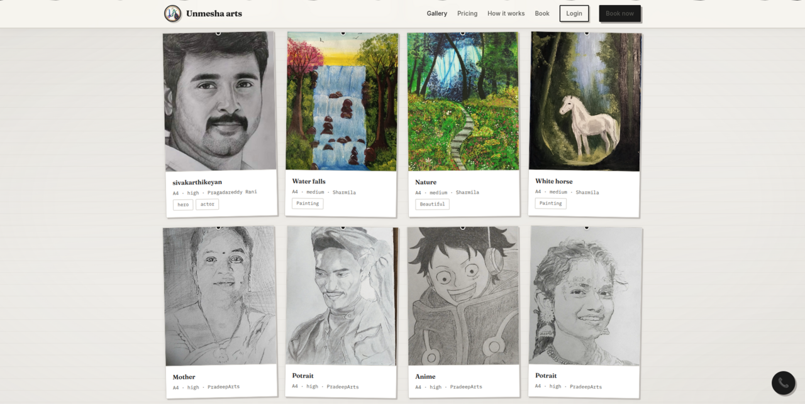

---

### Pricing Section
Transparent pricing cards by size and detail level. Extra faces add 40% on top. Price is calculated instantly in the booking form — no hidden costs.

| Size | Low | Medium | High |
|------|-----|--------|------|
| A4 | ₹799 | ₹999 | ₹1299 |
| A3 | ₹1299 | ₹1399 | ₹1499 |
| A2 | ₹1999 | ₹2099 | ₹2199 |

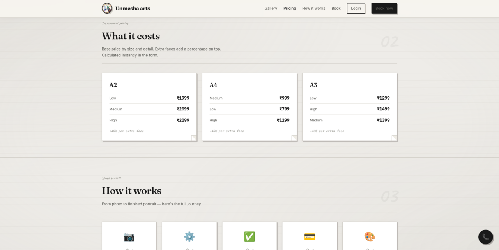

---

### How it Works
Six-step process cards: Upload your photo → Choose options → Artist confirms → Pay by UPI → We draw it → Shipped to you.

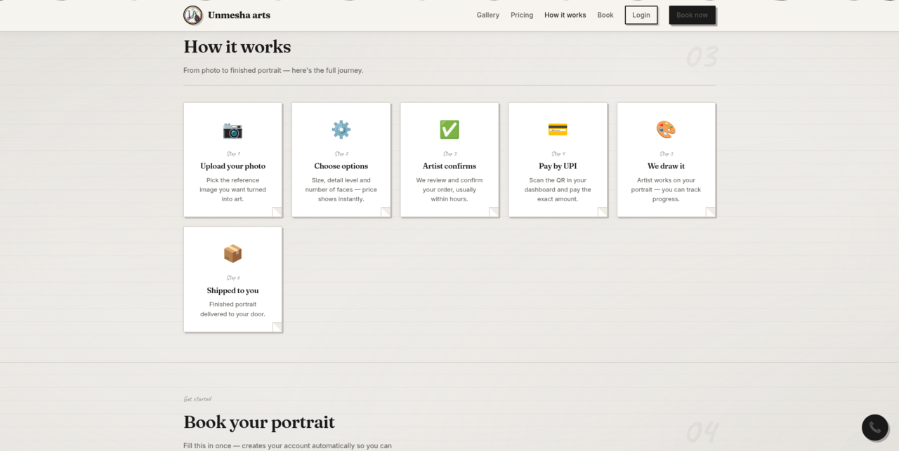

---

### Booking Form — Options
The booking form: upload reference photo, pick artist, size (A2/A3/A4), detail level (Low/Medium/High), number of faces. Estimated price updates instantly. Side panel shows contact options (Call, WhatsApp, Instagram) and a summary of what you get.

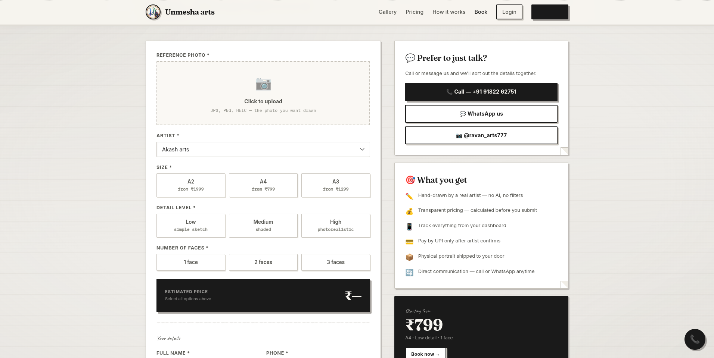

---

### Booking Form — Customer Details
Lower half of the booking form: full name, phone, email, password, delivery address, notes for artist. Submitting creates the customer account automatically — no separate sign-up needed.

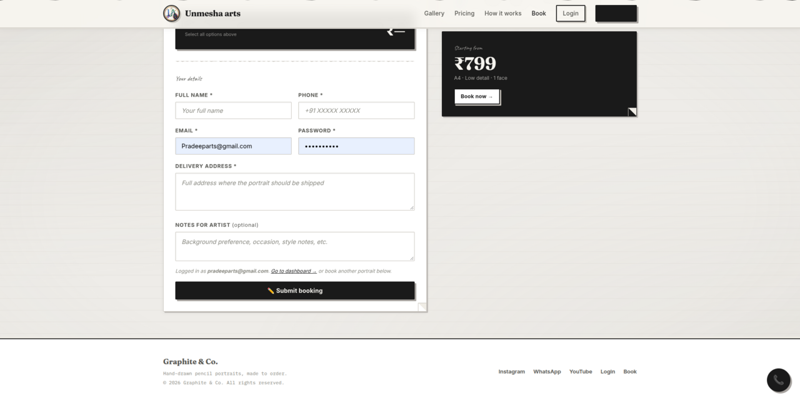

---

### Customer Dashboard — My Orders
Customer dashboard after login. Three tabs: My Orders, My Portraits, Profile. Shows all orders placed with status tracking.

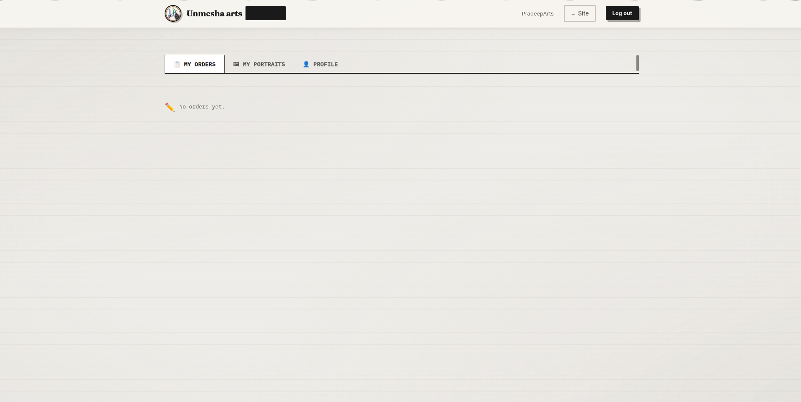

---

### Artist Dashboard — My Portraits
Artist dashboard showing the **My Portraits** tab with the Add Portrait form (upload, orientation, title, size, detail, tags, display price) and the live gallery on the right — 5 portraits listed including "Mother" sketch.

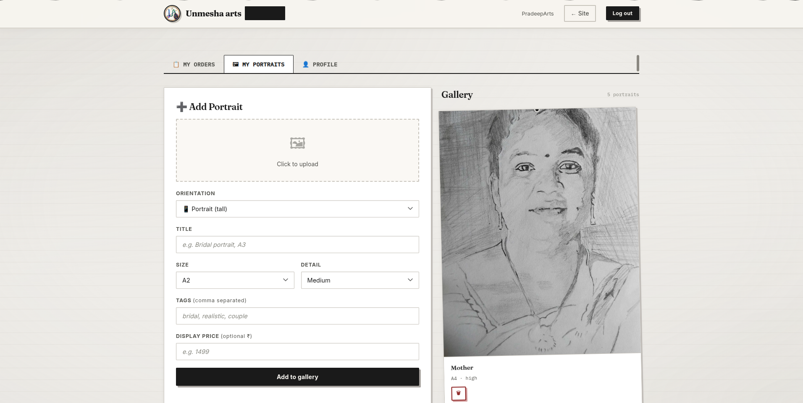

---

### Artist Dashboard — Profile
Artist profile tab: name, phone, email, UPI ID (used to generate QR codes for payments), bio, and password change.

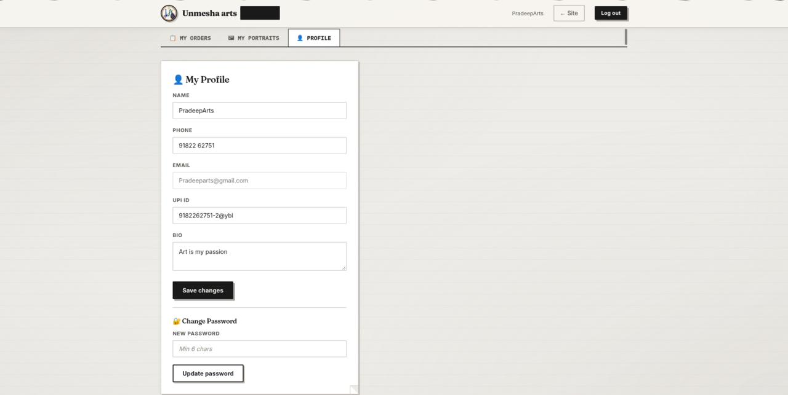

---

### Admin Dashboard — Overview
Admin overview: total orders, pending, in progress, completed, revenue, customers (2), artists (4), portraits (21). Recent orders panel and quick action buttons.

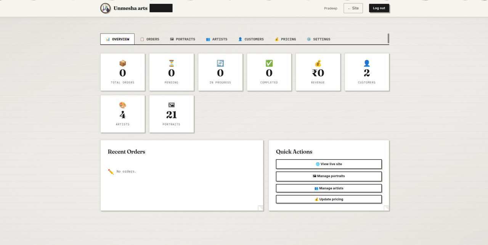

---

### Admin Dashboard — Portraits Tab
Admin portraits tab: Add Portrait form on the left (with artist assignment dropdown), full gallery on the right showing all 21 portraits with edit and delete controls.

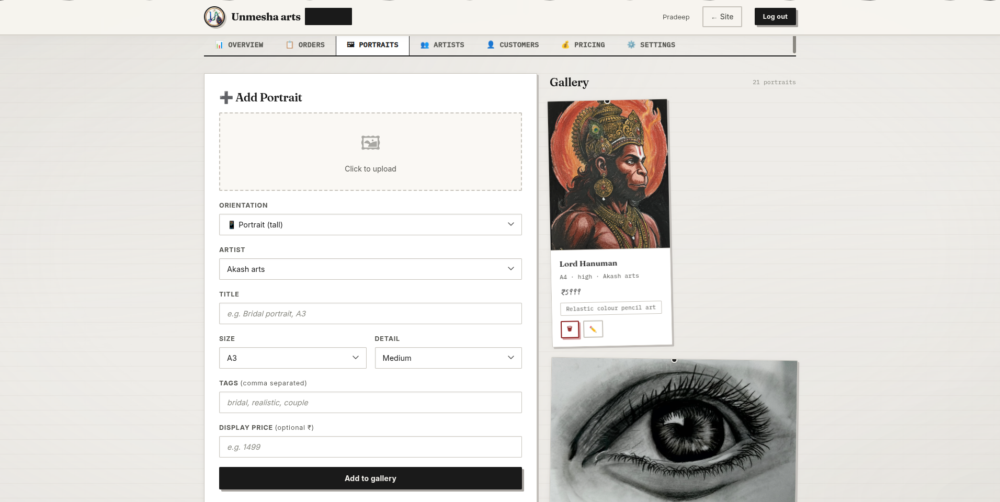

---

### Admin Dashboard — Artists Tab
Admin artists tab: Add Artist form (name, phone, email, password, UPI ID, bio) and the list of all 4 artists (Akash arts, Pragadareddy Rani…) with call, edit, and delete controls.

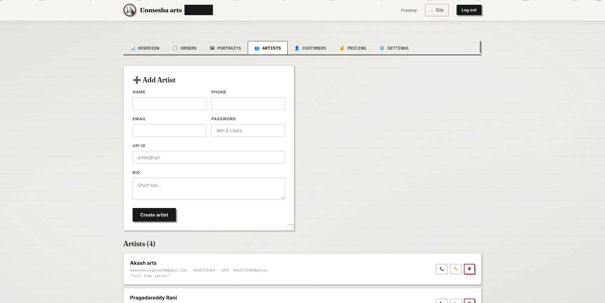

---

### Admin Dashboard — Customers Tab
Admin customers tab: full list of registered customers with email, phone, and call/WhatsApp/delete controls.

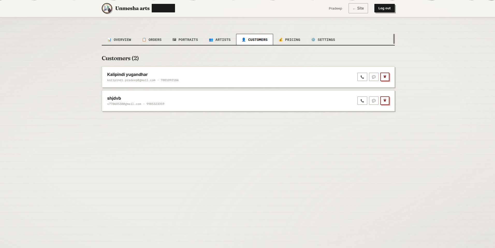

---

### Admin Dashboard — Pricing Tab
Admin pricing matrix: edit base prices for every size (A2, A3, A4) and detail level (Low, Medium, High) directly from the dashboard. Changes reflect instantly on the public booking form.

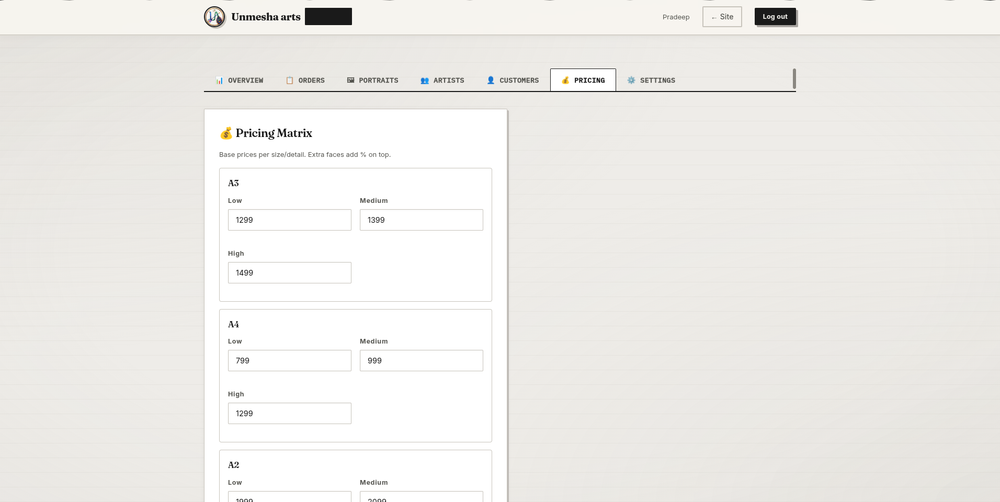

---

### Admin Dashboard — Settings Tab
Admin settings: Social & Contact links (Instagram, WhatsApp, Call number, YouTube) and a Data Management danger zone (delete all orders / portraits / customers / artists / everything).

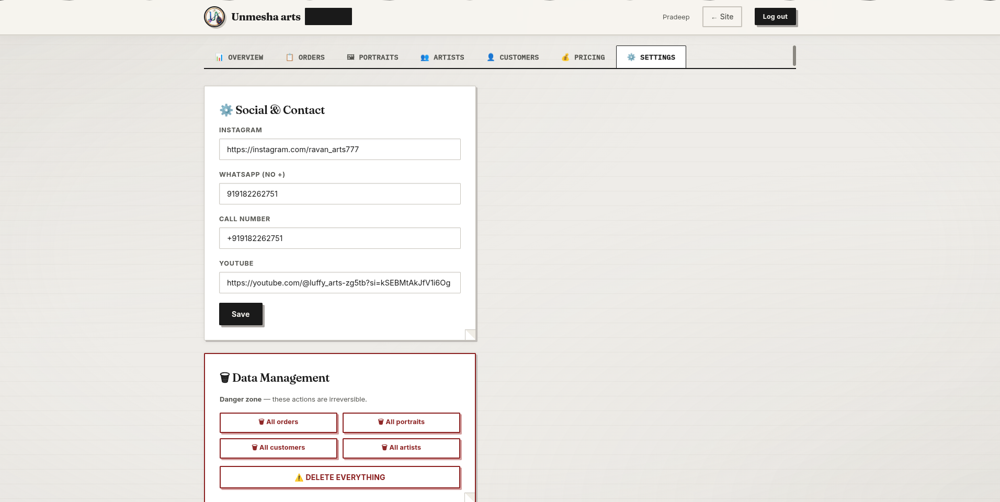

---

## Tech Stack

| Layer | Technology |
|---|---|
| Frontend | Vanilla HTML, CSS, JavaScript (no framework) |
| Hosting | Firebase Hosting (free tier) |
| Auth | Firebase Authentication (email/password) |
| Database | Cloud Firestore (NoSQL) |
| Image uploads | Cloudinary (unsigned upload preset) |
| Payments | UPI QR — generated on the fly from artist's UPI ID, no payment gateway |

---

## Project Structure

```
potrait/
├── index.html        — Public site: gallery, pricing, how it works, booking form
├── login.html        — Login for customers, artists, and admin
├── dashboard.html    — One dashboard, three views (customer / artist / admin) based on role
├── config.js         — Shared Firebase + Cloudinary config (loaded by all pages)
├── style.css         — Shared design system
├── pradeep.png       — Logo file (replace with your own, keep this filename)
├── public/           — Static assets
├── .firebaserc       — Firebase project config
├── firebase.json     — Firebase Hosting config
└── .github/workflows — CI/CD (Firebase deploy on push)
```

---

## How it works (user flow)

```
Customer visits index.html
  └─ Browses gallery & pricing
  └─ Fills booking form (uploads photo, picks options)
  └─ Account created automatically on submit → redirected to dashboard

Artist logs in → dashboard.html (artist view)
  └─ Sees new order → clicks Confirm order → status: confirmed
  └─ Clicks Send payment QR → enters final amount → UPI QR generated on screen
  └─ Customer sees QR in their dashboard → scans & pays → uploads screenshot
  └─ Artist clicks Mark payment confirmed → Mark completed

Admin logs in → dashboard.html (admin view)
  └─ Overview: all orders, revenue, artists, customers
  └─ Can add/remove artists, manage portraits, update pricing, configure social links
```

---

## Roles

| Role | How to get it | What they can do |
|---|---|---|
| **Customer** | Auto-created when booking | Track orders, pay via UPI QR, upload payment screenshot |
| **Artist** | Created by admin only | Manage own portraits, view & fulfil own orders, generate UPI QR |
| **Admin** | Set manually in Firestore | Everything — all orders, all artists, all customers, pricing, settings |

---

## Setup & Deployment

### 1. Firebase setup

```bash
# Install Firebase CLI
npm install -g firebase-tools
firebase login

# In the project folder
firebase init hosting    # point to root folder, index.html as entry
firebase deploy
```

### 2. Firestore security rules

Paste these in Firebase Console → Firestore → Rules:

```
rules_version = '2';
service cloud.firestore {
  match /databases/{database}/documents {
    function isSignedIn() { return request.auth != null; }
    function myRole() { return get(/databases/$(database)/documents/users/$(request.auth.uid)).data.role; }
    function isAdmin() { return isSignedIn() && myRole() == 'admin'; }
    function isArtist() { return isSignedIn() && myRole() == 'artist'; }

    match /users/{uid} {
      allow read: if isSignedIn();
      allow create: if isSignedIn() && request.auth.uid == uid;
      allow update: if isSignedIn() && (request.auth.uid == uid || isAdmin());
    }
    match /portraits/{id} {
      allow read: if true;
      allow write: if isAdmin() || (isArtist() && request.resource.data.artistId == request.auth.uid);
      allow delete: if isAdmin() || (isArtist() && resource.data.artistId == request.auth.uid);
    }
    match /orders/{id} {
      allow create: if isSignedIn();
      allow read: if isAdmin() || (isSignedIn() && (resource.data.customerId == request.auth.uid || resource.data.artistId == request.auth.uid));
      allow update: if isAdmin() || (isSignedIn() && (resource.data.customerId == request.auth.uid || resource.data.artistId == request.auth.uid));
    }
    match /settings/{doc} {
      allow read: if true;
      allow write: if isAdmin();
    }
  }
}
```

### 3. Cloudinary upload preset

1. Firebase Console → Settings → Upload → Add upload preset
2. Name: `portrait_unsigned`, Signing mode: **Unsigned**, Folder: `portraits`
3. Update `config.js` with your Cloudinary cloud name

### 4. Make yourself admin

1. Firebase Console → Authentication → Add user (your email + password)
2. Copy the UID
3. Firestore → `users` collection → new document with that UID → field `role: "admin"`
4. Log in at `/login.html` — you'll land on the admin dashboard

---

## Pricing

Starting from **₹799** (A4, low detail, 1 face). All prices editable live from the admin dashboard.

| Size | Low | Medium | High |
|------|-----|--------|------|
| A4 | ₹799 | ₹999 | ₹1299 |
| A3 | ₹1299 | ₹1399 | ₹1499 |
| A2 | ₹1999 | ₹2099 | ₹2199 |

+40% per extra face.

---

## Author

**Vivek Talagaturi** — Full-Stack Developer & CSE undergrad (B.Tech 2024–2028)

- GitHub: [github.com/24B11CS433vivek](https://github.com/24B11CS433vivek)
- LinkedIn: [linkedin.com/in/talagaturi-vivek](https://linkedin.com/in/talagaturi-vivek)
- Email: vivektalagaturi@gmail.com
